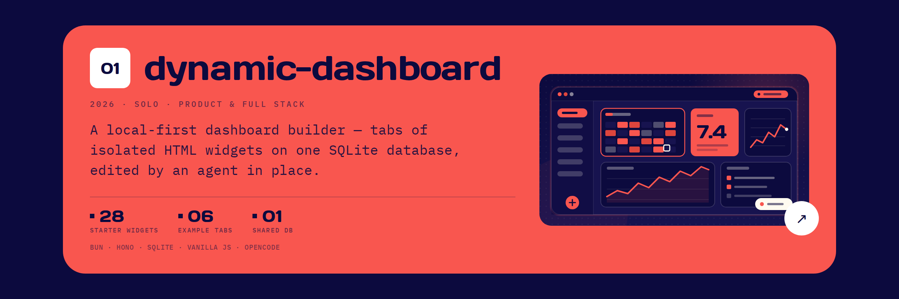
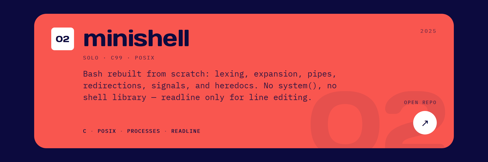
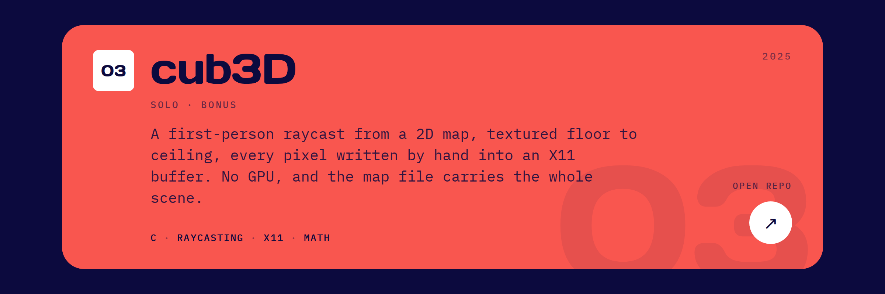
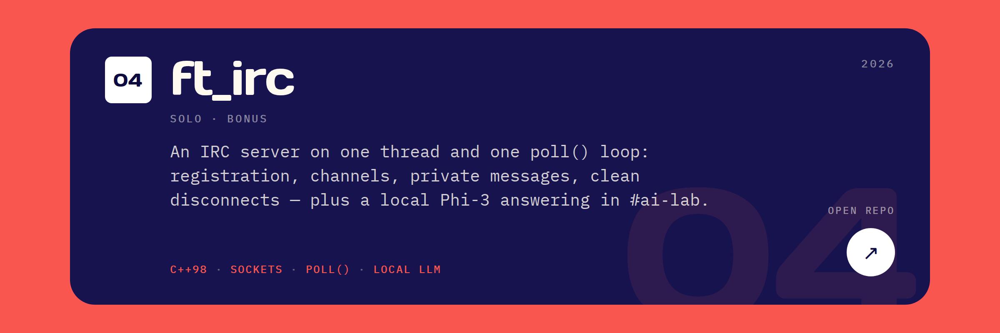
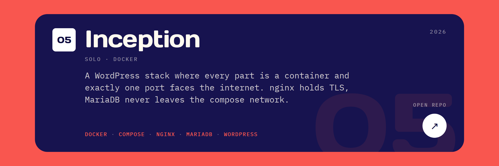
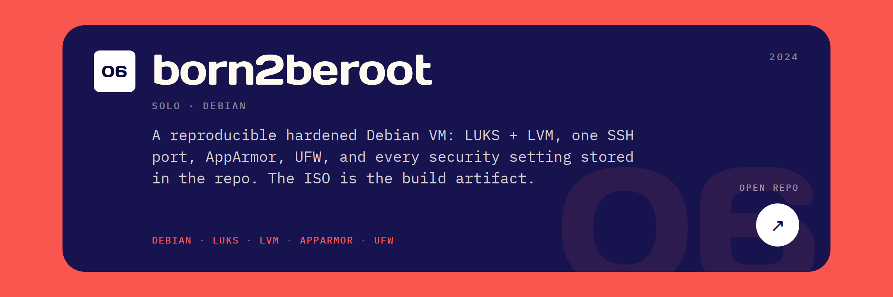
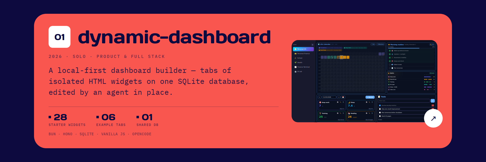

<!-- Private review: the full image-only deck with only the first project plate swapped for dynamic-dashboard. The public profile is untouched. -->

<strong>A · Custom flat illustration</strong> ambient palette, drawn inline as SVG

<strong>B · Native screenshot</strong> Personal OS tab, cropped 720 × 405

