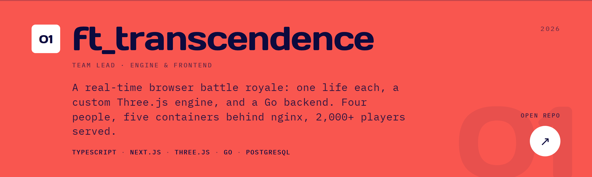

<!-- Edouard Normand — image-only profile. Artwork and palette mirror the portfolio's ambient edition (navy #0c0a3e, coral #f9564f, Days One + IBM Plex Mono). Regenerate with: python assets/readme/build.py. Every plate is a separate linked PNG stacked flush with . -->

