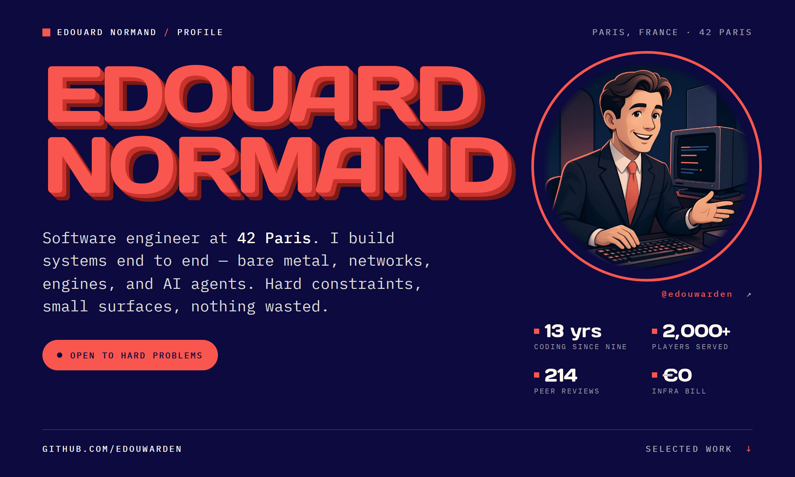
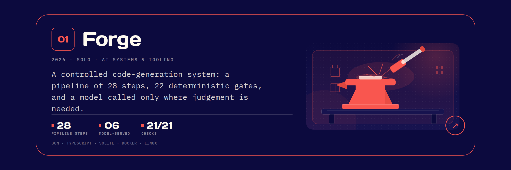
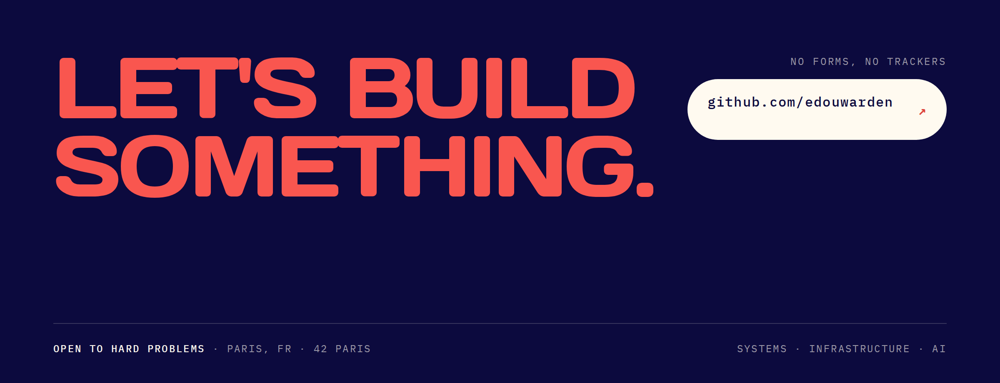

<!-- Private review: the full image-only deck with a custom flat illustration on every project card. The Space card is a static generated-world cross-section. The public profile is untouched. -->

