<!-- Private review: the full image-only deck with a custom flat illustration on every project card. A thin animated open-to-work strip for Switzerland sits above the header. A live stack strip, a language line and a project-section header sit between the header and the plates; Forge opens the work section as an outlined in-progress card with a live ember pulse, Financial-Market-Theories, AEGIS Fabric, Trading-Support-Tools, space-gameserver, dynamic-dashboard and ft_transcendence follow at full size, and minishell, cub3D, ft_irc, Inception and born2beroot close it as compact cards; every card ends with a full-width footer, with date and team chips on the left and the stack chip on the right. A thin try-it strip follows the dashboard card; a peer-review marquee follows the last plate, and the footer leads with "Bring me a hard problem" before the email line and an updated stamp. A collapsed text version follows the deck. The Space card shows the seeded height field and core sample; born2beroot shows a VM window on a hypervisor host. The public profile is untouched. -->

<a href="mailto:ed.normand@protonmail.com" title="Email Edouard Normand">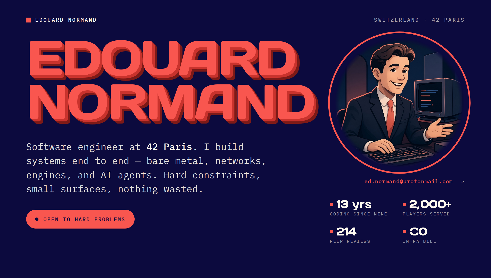</a><a href="mailto:ed.normand@protonmail.com" title="Email Edouard Normand"></a><a href="mailto:ed.normand@protonmail.com" title="Email Edouard Normand">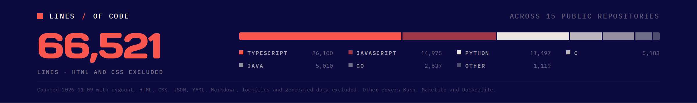</a><a href="mailto:ed.normand@protonmail.com" title="Email Edouard Normand">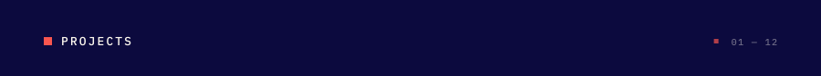</a><a href="https://github.com/edouwarden/Financial-Market-Theories" title="Financial-Market-Theories">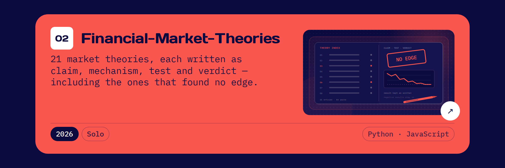</a><a href="https://github.com/edouwarden/aegis-fabric" title="AEGIS Fabric">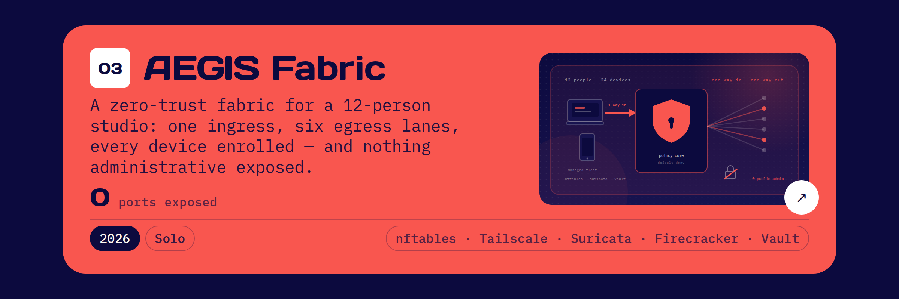</a><a href="https://github.com/edouwarden/Trading-Support-Tools" title="Trading-Support-Tools">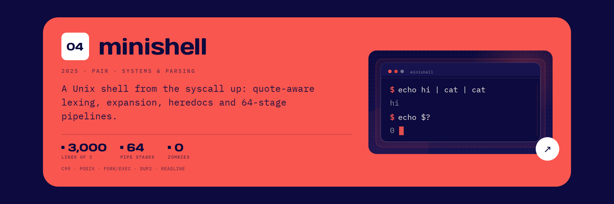</a><a href="https://github.com/edouwarden/space-gameserver-2019-psr" title="space-gameserver">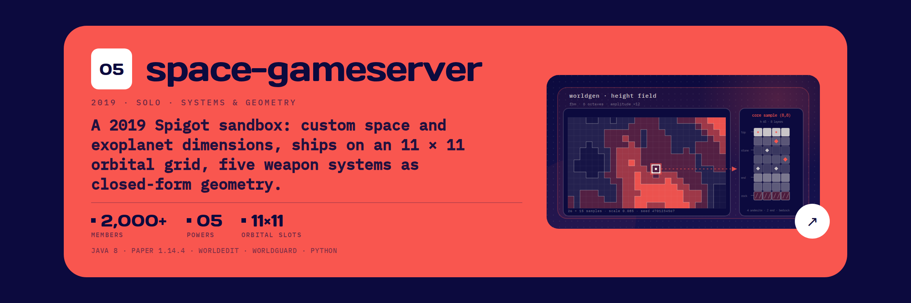</a><a href="https://github.com/edouwarden/dynamic-dashboard" title="dynamic-dashboard">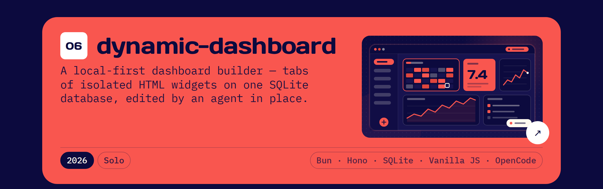</a><a href="https://github.com/edouwarden/Transcendence-WebGameEngine" title="ft_transcendence">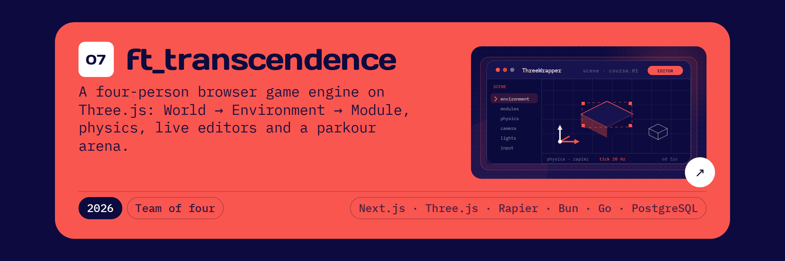</a><a href="https://github.com/edouwarden/minishell" title="minishell">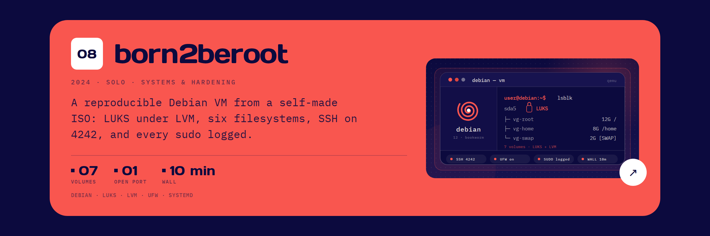</a><a href="https://github.com/edouwarden/cube3D" title="cub3D">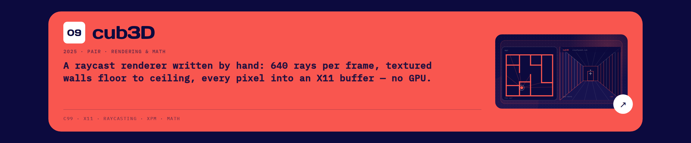</a><a href="https://github.com/edouwarden/irc" title="ft_irc">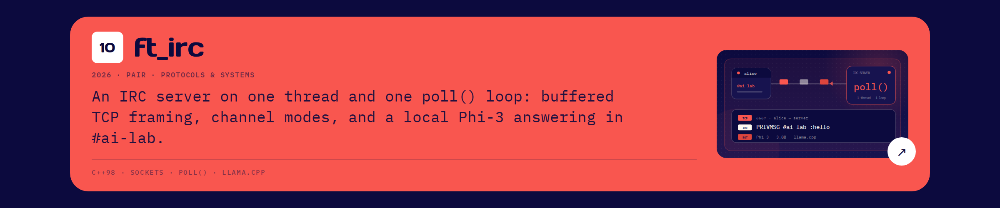</a><a href="https://github.com/edouwarden/inception" title="Inception">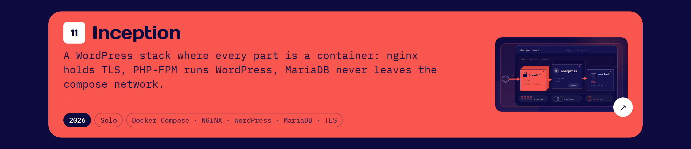</a><a href="https://github.com/edouwarden/born2beroot" title="born2beroot">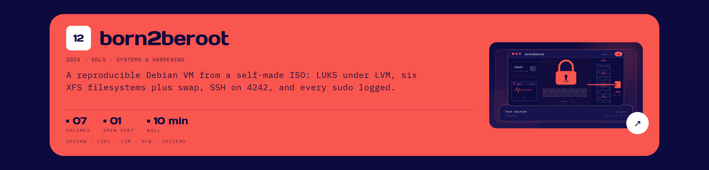</a><!-- Mock peer-review quotes: replace REVIEWS in stats.py before publishing. --><a href="mailto:ed.normand@protonmail.com" title="Email Edouard Normand">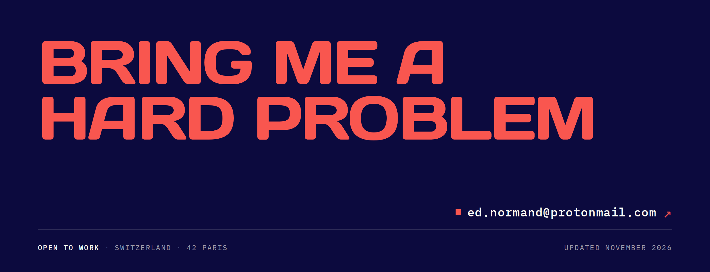</a>

<b>Read this profile as text</b>

**Edouard Normand** — software engineer at 42 Paris, based in Switzerland and open to work.

I build systems end to end: bare metal, networks, engines, and AI agents. Hard constraints, small surfaces, nothing wasted.

13 years coding · 2,000+ players served · 214 peer reviews · €0 infra bill.

**Selected work**

- **Forge** — 2026, solo, in progress. A controlled code-generation system: a 28-step pipeline, 22 deterministic gates, and a model called only where judgement is needed. 28 steps. Bun, TypeScript, SQLite, Docker, Linux. [Repository](https://github.com/edouwarden/theforge).
- [Financial-Market-Theories](https://github.com/edouwarden/Financial-Market-Theories) — 2026, solo. 21 market theories, each written as claim, mechanism, test and verdict — including the ones that found no edge. Python, JavaScript.
- [AEGIS Fabric](https://github.com/edouwarden/aegis-fabric) — 2026, solo. Infrastructure and security for a 12-person studio. A zero-trust fabric: one ingress, six egress lanes, every device enrolled, no public admin plane. 0 ports exposed. nftables, Tailscale, Suricata, Firecracker, Vault.
- [Trading-Support-Tools](https://github.com/edouwarden/Trading-Support-Tools) — 2026, solo. A perpetual-futures bot and the tooling around it: a crash-safe order lifecycle and a 1,059-row journal that survived real use. 1,059 journal rows. JavaScript, Python, SQLite.
- [space-gameserver](https://github.com/edouwarden/space-gameserver-2019-psr) — 2019, solo. A Spigot sandbox with seeded space and exoplanet terrain, ships on an 11 × 11 orbital grid, and five weapon systems as closed-form geometry. 2,000+ members. Java 8, Paper 1.14.4, Python.
- [dynamic-dashboard](https://github.com/edouwarden/dynamic-dashboard) — 2026, solo. A local-first dashboard builder: tabs of isolated HTML widgets on one SQLite database, edited by an agent in place. Bun, Hono, SQLite, Vanilla JS, OpenCode. [Try it](https://dynamic-dashboard.ednormand.fr/).
- [ft_transcendence](https://github.com/edouwarden/Transcendence-WebGameEngine) — 2026, team of four. Team lead · engine & frontend. A browser game engine on Three.js with World, Environment and Module layers, physics, live editors and a parkour arena. Next.js, Three.js, Rapier, Bun, Go, PostgreSQL.
- [minishell](https://github.com/edouwarden/minishell) — 2025, pair. A Unix shell from the syscall up: quote-aware lexing, expansion, heredocs and 64-stage pipelines. 0 zombies left. C99, POSIX, fork/exec, dup2, readline.
- [cub3D](https://github.com/edouwarden/cube3D) — 2025, pair. A hand-written raycast renderer: 640 rays per frame, textured walls, every pixel into an X11 buffer, no GPU. C99, X11, XPM, math.
- [ft_irc](https://github.com/edouwarden/irc) — 2026, pair. An IRC server on one thread and one poll loop, with buffered TCP framing, channel modes, and a local model answering in #ai-lab. 3.8B local model. C++98, sockets, poll(), llama.cpp.
- [Inception](https://github.com/edouwarden/inception) — 2026, solo. A WordPress stack where every part is a container: nginx holds TLS, PHP-FPM runs WordPress, MariaDB never leaves the compose network. 1 open port. Docker Compose, NGINX, WordPress, MariaDB, TLS.
- [born2beroot](https://github.com/edouwarden/born2beroot) — 2024, solo. A reproducible Debian VM from a self-made ISO: LUKS under LVM, six XFS filesystems plus swap, SSH on 4242, every sudo logged. Debian, LUKS, LVM, UFW, systemd.

**Stack** — Bun, Hono, SQLite, OpenCode, Next.js, Three.js, Rapier, Spigot, llama.cpp, PostgreSQL, Tailscale, Cloudflare; TypeScript, Python, C, C++, Go, Java, Docker, NGINX, Debian, LUKS, LVM, Vault, nftables, Suricata, Firecracker.

**Languages by share of counted lines** — TypeScript 39.2%, JavaScript 22.5%, Python 17.3%, C 7.8%, Java 7.5%, Go 4.0%, Bash 1.7%.

**Peer reviews** — available on request.

**Education** — 42 Paris, low-level development and systems, 2024–present; common core completed June 2026, 214 peer reviews, ranked top 7% of 7,500 in the Piscine. Université Paris-Saclay, economics and management, 2023–2024. Sup de Vinci, Paris, computer science, 2022–2023, ranked first in class. Baccalauréat STI2D, 2022, with honors.

**Off the clock** — rollerblade hockey, snowboard and ski, surf, track driving, TIG welding and electronics.

**Contact** — [ed.normand@protonmail.com](mailto:ed.normand@protonmail.com)

