# Option A — animated tag inside the header

The existing pill becomes a coral `Open to work · Switzerland` tag with a pulsing dot. No extra strip, so the deck keeps its current height. This is the version currently used on the main deck.

<a href="mailto:ed.normand@protonmail.com" title="Email Edouard Normand"></a><a href="mailto:ed.normand@protonmail.com" title="Email Edouard Normand"></a><a href="mailto:ed.normand@protonmail.com" title="Email Edouard Normand">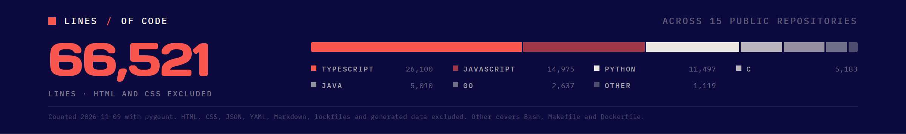</a><a href="mailto:ed.normand@protonmail.com" title="Email Edouard Normand">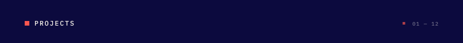</a><a href="https://github.com/edouwarden/Transcendence-WebGameEngine" title="ft_transcendence">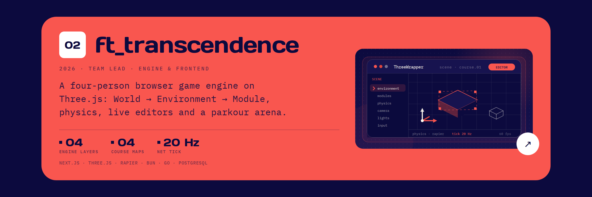</a><a href="https://github.com/edouwarden/space-gameserver-2019-psr" title="space-gameserver">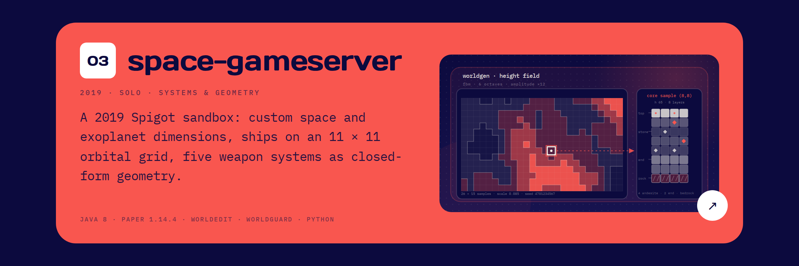</a><a href="https://github.com/edouwarden/minishell" title="minishell">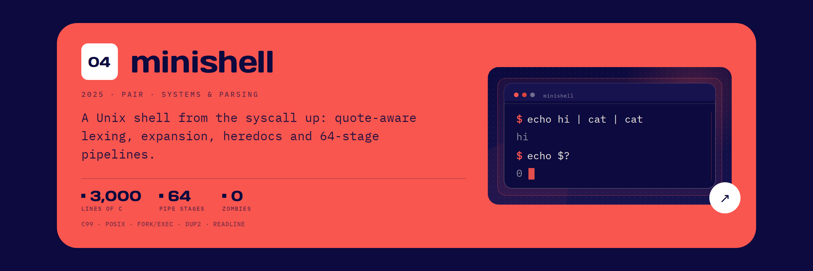</a><a href="https://github.com/edouwarden/cube3D" title="cub3D">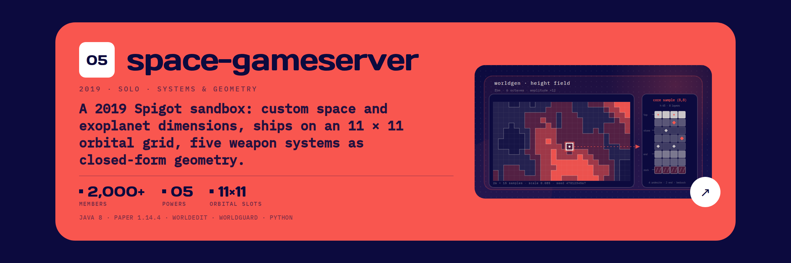</a><a href="https://github.com/edouwarden/irc" title="ft_irc">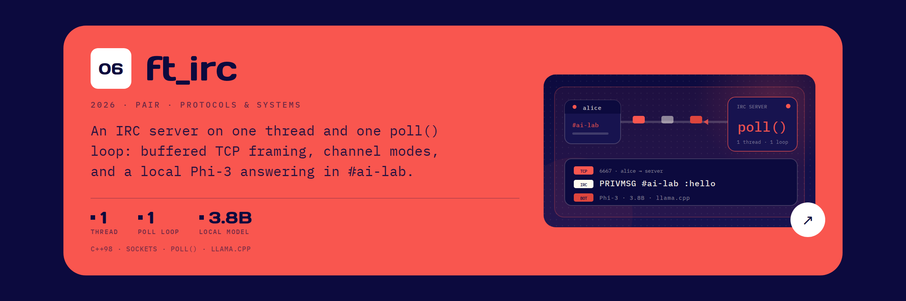</a><a href="https://github.com/edouwarden/inception" title="Inception">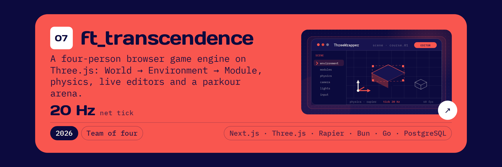</a><a href="https://github.com/edouwarden/born2beroot" title="born2beroot">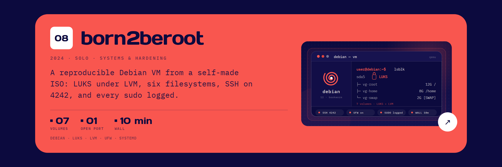</a><a href="https://github.com/edouwarden?tab=repositories" title="Forge — in progress"></a><!-- Mock peer-review quotes: replace REVIEWS in stats.py before publishing. --><a href="mailto:ed.normand@protonmail.com" title="Email Edouard Normand">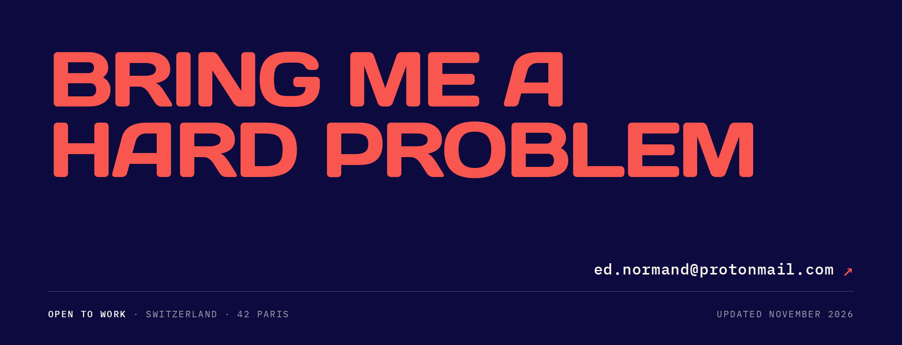</a>

Compare: **A** · [B](option-b.md) · [C](option-c.md)
